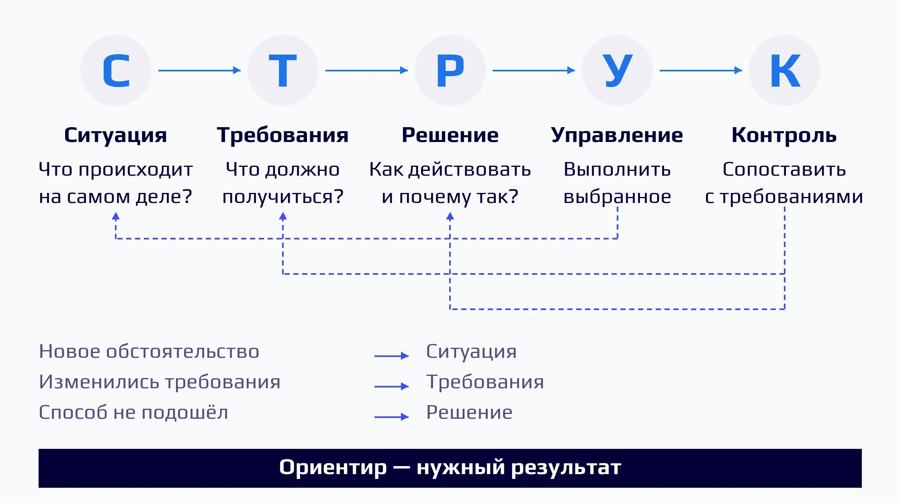

# СТРУК — скилл для ИИ

**СТРУК** — способ мыслить и действовать в жизни и работе, разработанный Юрием Струком. Скилл помогает ИИ связать понимание ситуации, нужный результат, выбор решения, выполнение и проверку. Метод применим и без ИИ.

## Начать

- **Codex, Claude Code, Gemini CLI, Copilot, Hermes Agent и OpenClaw:** скопируйте папку [struk](struk/) в каталог навыков своего приложения. [Пути и проверка для каждого приложения](COMPATIBILITY.md).
- **Claude web:** скачайте [struk.zip](struk.zip) и загрузите архив в настройках навыков, если функция доступна в вашем аккаунте.
- **ChatGPT, DeepSeek и другие чаты:** скопируйте [универсальную инструкцию](UNIVERSAL-PROMPT.md) в сообщение или добавьте её к существующим инструкциям проекта/ассистента. Для DeepSeek API текст передаётся в системном сообщении.

Пример: «Используй СТРУК: помоги разобраться, почему люди не завершают заказ, предложи следующий шаг и покажи, что известно, а что пока предположение».

СТРУК учитывает цель и границы поручения, а не требует пяти документов или заголовков. Возможности ИИ, доступ к данным и разрешения определяются вашей средой.

## Состав и лицензия

Текущая версия скилла — **0.3.1**. Единственный исходник — [struk/SKILL.md](struk/SKILL.md); архив `struk.zip` содержит точную копию его папки для установки. [Проверка связи с целью](struk/references/goal-check.md) — дополнительный материал скилла.

Автор методологии — Юрий Струк. Тексты скилла и документации распространяются на условиях [CC BY 4.0](https://creativecommons.org/licenses/by/4.0/) в пределах прав правообладателя. Сохраняйте указание автора, ссылку на источник и лицензию и отмечайте изменения. [Полный текст](LICENSE) · [область лицензии и исключения](LICENSING.md). Права на изображение схемы требуют отдельной проверки.

Пакет проверен структурно; подключение каждого приложения и независимая оценка качества не подтверждены. Репозиторий пока приватный: доступ к нему имеют приглашённые пользователи.
