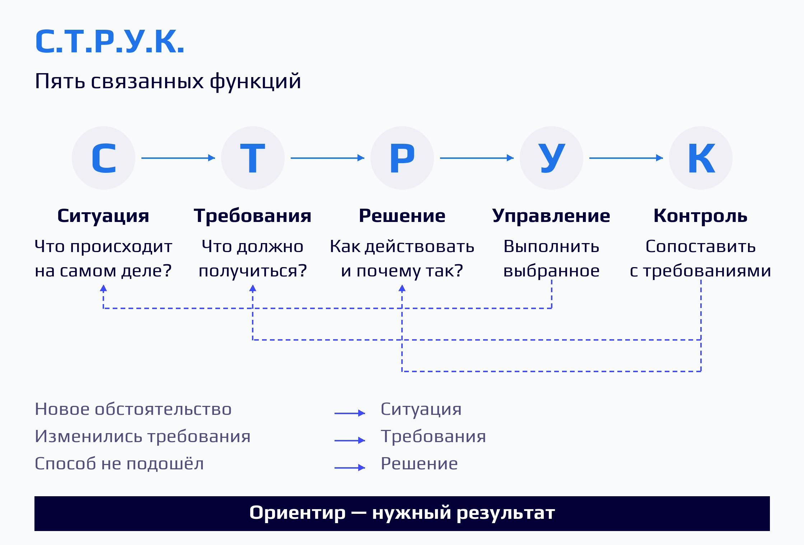
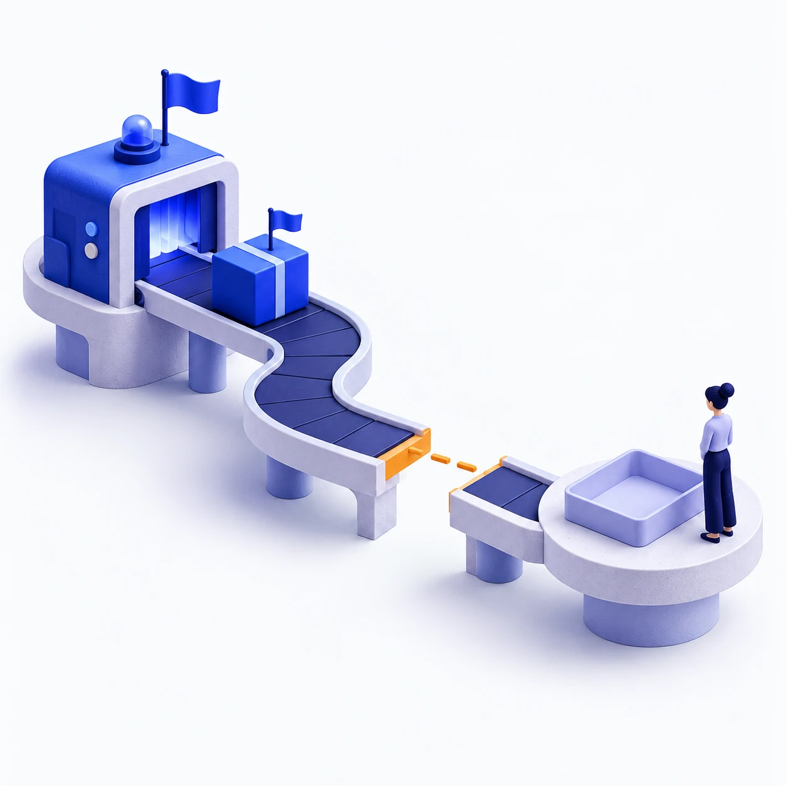

# Методология С.Т.Р.У.К. — способ мыслить и действовать

Когда я решил описать свой подход к решению задач так, чтобы им могли пользоваться другие, обнаружилось занятное совпадение. Ситуация, Требования, Решение, Управление, Контроль — первые буквы сложились в мою фамилию: С.Т.Р.У.К. Я жил с этой фамилией, разбирался с повседневными делами, создавал продукты, принимал решения и долго не замечал, что она может служить ещё и памяткой о том, как вести дело от понимания происходящего до проверки результата.

Пока я работаю сам, многое происходит почти незаметно. Я учитываю обстоятельства, уточняю, что нужно получить, выбираю способ, действую, по ходу что-то пересматриваю. Объяснить другому человеку, как я пришёл к решению, уже сложнее: приходится восстанавливать основания выбора и связи, которые для меня самого казались очевидными. Когда я стал оформлять этот подход для передачи другим людям, а затем и ИИ-агентам, понадобилось сделать эту логику явной — показать, какие вопросы я задаю, на что опираюсь и как понимаю, что задача действительно решена.

## Назначение и область применения

**СТРУК — мой способ мыслить и действовать в жизни и работе, оформленный в пять связанных функций.** Они помогают удерживать связь между происходящим, нужным результатом и действиями, которые должны к нему привести.

Дело может остановиться по разным причинам: не хватает сведений, непонятно, что должно получиться, выбран неподходящий способ, решение остаётся на бумаге или результат ещё не проверен. Бывает и так, что работа идёт полным ходом, а исходная задача остаётся нерешённой. Команда выпускает новые функции, хотя не выяснила, почему пользователи уходят; руководитель пересобирает план, а продукт по-прежнему не выполняет свою основную задачу. СТРУК даёт опору, чтобы замечать такие разрывы и возвращать действия к нужному результату.

Метод применим к личным делам, совместной работе, управлению и взаимодействию с ИИ. В личной задаче вы сами определяете нужное состояние и действуете. Когда участвуют другие люди, нужно в достаточной мере договориться о результате, ограничениях и участии каждого. При работе с ИИ те же вопросы помогают сформулировать поручение и проверить ответ. Программы, помощники и специальные документы для применения СТРУК не обязательны: глубина разбора зависит от самого дела. На этом сайте метод раскрывается прежде всего через продуктовое управление — диагностику, создание и развитие цифровых продуктов. Предметное содержание даёт практика Product Lead: работа с ценностью для пользователя, моделью продукта и бизнеса, архитектурой, командой, запуском и эксплуатацией. СТРУК связывает эти решения между собой и с нужным результатом.

## Как устроен СТРУК

| Функция | Главный вопрос | Что получаем |
|---|---|---|
| С — Ситуация | Что происходит на самом деле? | Понимание исходного положения и существенных неизвестных |
| Т — Требования | Что должно получиться и что нужно учесть? | Условия нужного результата |
| Р — Решение | Как будем этого добиваться и почему так? | Выбранный способ действия |
| У — Управление | Что делаем и как ведём дело? | Выполнение решения с учётом происходящего |
| К — Контроль | Что получилось относительно требований? | Проверка результата и понимание следующего действия |

Требования опираются на ситуацию, решение выбирают ради нужного результата, управление ведёт выполнение, контроль сопоставляет полученное с требованиями. При этом функции связаны в обе стороны. Проверка может обнаружить ошибку в выборе способа, выполнение — новое обстоятельство, а уточнение требований — показать, каких сведений о ситуации не хватает. Поэтому СТРУК допускает возвращение к любому вопросу, который изменился или остался без достаточного ответа.

<figure class="wp-block-image struk-illustration" data-struk-asset="functions-map" style="margin:2em 0">
<picture>
<source media="(max-width:767px)" type="image/webp" srcset="assets/functions-map-mobile.webp" width="800" height="2300">

</picture>
<figcaption style="font-size:0.95em;line-height:1.5;margin-top:0.75em">При новых обстоятельствах можно вернуться к затронутой функции и пересмотреть дальнейшее действие.</figcaption>
</figure>

## С — Ситуация

**Ситуация — понимание того, что происходит и в каких условиях предстоит действовать.** Здесь важны факты, участники, причины, ограничения и неизвестные, способные повлиять на выбор. Начните с конкретного описания: фраза «продукт не работает» почти ничего не даёт для решения, а «пользователи регистрируются, но не завершают основной сценарий» уже задаёт направление проверки. При этом наблюдение и его объяснение стоит различать. «Пользователь остановился на настройке» — наблюдение; «ему не нужна эта функция» — возможное объяснение, для которого нужны основания.

Вместо описания ситуации иногда сразу предлагают готовое средство: «Нам нужен новый сайт». За этим может стоять вполне обоснованная потребность, но сначала стоит понять, что именно происходит и какое затруднение должен изменить сайт. Возможно, его действительно нужно заменить. Возможно, причина находится в другом месте, а замена сохранит прежнюю проблему. Если нужный факт пока недоступен, неизвестность следует оставить видимой и определить, нужно ли устранять её сейчас. Отсутствие сведений само по себе не доказывает, что дела обстоят плохо.

Для начала действий достаточно разобраться в существенных обстоятельствах и понять, каких сведений не хватает для ближайшего выбора. Полное описание мира здесь не требуется: выяснять стоит прежде всего то, что способно изменить дальнейшее действие. Из одной и той же ситуации могут следовать разные намерения. Сломанную вещь можно восстановить, заменить или временно обойтись без неё; подходящий результат зависит от того, что человеку нужно. Этот выбор проясняется в требованиях.

## Т — Требования

**Требования — условия, которым должен отвечать нужный результат.** Они помогают определить, к какому состоянию вы стремитесь, кому оно нужно, какие ограничения существенны и по чему можно судить о завершении дела. В личной задаче эти условия человек определяет сам. В совместной работе нужно убедиться, что участники одинаково понимают достаточность результата. Для простой просьбы отдельное согласование не требуется, если её смысл уже ясен, но в длинном деле расхождение ожиданий лучше обнаружить до выполнения.

Требование может быть качественным: пользователь понимает следующий шаг, сотрудник может обработать заявку, заказчик получает обоснованный ответ на вопрос аудита. Число полезно там, где оно выражает существенное условие, например предел расходов или допустимое время обработки. Важно также отделять результат от способа его получить. «Клиент может самостоятельно оформить заказ» описывает нужное состояние, а «переделать интерфейс» — возможный способ его достичь. Интерфейс можно переделать, сохранив препятствие в оплате или оформлении. Если же человеку поручили только подготовить макет, достаточность проверяют в границах этого поручения; ответственность за внедрение и дальнейший эффект не возникает автоматически.

Требования достаточно определены для ближайшего действия, когда вы можете объяснить, что будет подходящим результатом и какие ограничения нельзя потерять. Если нужный результат меняется, это изменение следует назвать и пересмотреть затронутые решения и договорённости. Новое условие нельзя незаметно добавлять при проверке, будто оно существовало с самого начала: иначе выполненное поручение будет бесконечно превращаться в другое.

## Р — Решение

**Решение — выбранный способ получить нужный результат в данных условиях.** Оно связывает понимание ситуации и требований с тем, что предстоит делать. Основание выбора можно проверить тремя вопросами: какое требование обслуживает действие, что известно об исходном положении и почему этот способ должен приблизить нужное состояние. Когда существенных вариантов несколько, их сравнивают по относящимся к задаче условиям: времени, ресурсам, последствиям, доступности и ограничениям. Для очевидного небольшого дела достаточно прямого выбора.

Если неизвестное способно изменить решение, ближайшим действием может стать получение сведений. Полезно заранее понимать, какие ответы повлияют на выбор и когда исследования будет достаточно. Для длинного дела нужно также определить ближайшие действия, зависимости и условия пересмотра, а в совместной работе — участие людей и доступные им полномочия. План связывает действия в исполнимую последовательность; при его подготовке нужно проверить доступность ресурсов и существенные зависимости.

Знакомый инструмент легко становится решением по умолчанию. Презентация, новая программа, уборка или совещание могут быть полезны, когда понятно, какую часть задачи они решают. Если действие успешно закончится, а нужное состояние останется прежним, стоит проверить его место в работе. Возможно, это необходимый промежуточный шаг, от которого зависит продолжение. Возможно, удобное средство уже подменило цель, и тогда способ нужно пересмотреть.

> «Нет ничего бесполезнее, чем эффективно делать то, чего вообще не следовало делать».
>
> — Питер Друкер. Перевод с английского; [источник цитирования — Claremont Graduate University](https://www.cgu.edu/news/2026/04/what-ceos-can-learn-from-peter-drucker-in-a-layoff-economy/).

## У — Управление

**Управление — ведение выполнения выбранного решения.** В личном деле человек действует сам и следит за ходом работы: берёт необходимое, делает, замечает помехи и доводит доступную часть до результата. При выполнении приходится учитывать происходящее: что уже сделано, что мешает, от чего зависит следующий шаг и кто может его выполнить.

Когда участвуют другие люди, нужны договорённости об участии, ответственности и зависимостях. Важно понимать, кто выполняет действие, какие сведения и ресурсы ему переданы, какие полномочия доступны и кто принимает результат. Если исполнителю не хватает прав или исходных данных, эту зависимость нужно разрешить в пределах своих полномочий. Назначенный ответственный и отправленное поручение подтверждают передачу работы; фактически полученный результат предстоит установить отдельно.

По ходу выполнения условия могут измениться. Если перестал подходить выбранный способ, нужно вернуться к Решению; если обнаружилось существенное обстоятельство — к Ситуации; если изменился нужный результат — к Требованиям. В совместной работе новое удобное решение не даёт права молча изменить обещанное. Нужно обозначить, какую договорённость затрагивает изменение и как теперь продолжится работа. Для простой личной задачи всё это может занять несколько секунд и обойтись без отдельного руководителя или системы учёта.

## К — Контроль

**Контроль — сопоставление фактического результата с требованиями и целью.** Он помогает понять, завершено ли дело, что осталось и нужно ли пересматривать действия. Условия проверки вытекают из того, что требовалось получить: результат можно осмотреть, прочитать, испытать или уточнить у получателя. Достаточное свидетельство зависит от задачи. Для исправленной ошибки подойдёт повторная проверка сценария, для рабочего материала — проверка содержания и соответствия договорённости; дальнейший эффект потребует наблюдений после применения.

Здесь важно различать несколько результатов. Подготовленный план можно проверить на обоснованность и выполнимость. После работы по плану проверяют полученное, после передачи другому человеку — соответствие договорённости. Если важен дальнейший эффект, его проверяют отдельно. Например, подготовленный материал для обучения ещё предстоит применить, чтобы увидеть, чему научились участники. При поручении подготовить материал достаточно проверить качество подготовки; обещание научить людей потребует более широкой проверки.

Если обнаружен разрыв, нужно назвать невыполненное условие, разобраться в причине в доступной мере и вернуться к затронутой функции: уточнить обстоятельства, требования, способ или выполнение. По ходу проверки могут обнаружиться пропущенные последствия и новые условия — их следует явно учесть. Для промежуточного результата важно назвать оставшееся действие, а завершённое в согласованных границах дело можно закончить без добавления новых ритуалов.

## Как связаны функции

Связь функций держится на различении цели, требований и средства. Цель отвечает на вопрос, ради какого изменения вы действуете; требования уточняют, какой результат будет подходящим; средство — выбранный способ его получить. Если задача — дать пользователю возможность оформить заказ, выпуск новой версии может быть средством. Версия выпущена, но заказ по-прежнему нельзя завершить: действие выполнено, нужный результат не получен. То, какое изменение находится в границах поручения, определяют договорённости участников. Придумывать скрытую более высокую цель не нужно.

Возвращение к предыдущему вопросу требуется тогда, когда появились сведения или изменения, влияющие на работу. Это позволяет пересмотреть способ, не потеряв нужный результат, либо явно изменить требования, если прежние перестали подходить. Проверять такую связь полезно по ходу дела, пока ещё можно исправить выбор и выполнение. Одна итоговая проверка способна показать ошибку, которую раньше удалось бы заметить с меньшими затратами.

Глубина применения зависит от сложности, последствий ошибки, времени и участников. В простом деле пять функций могут пройти мысленно и почти одновременно. В длинном проекте полезно записывать основания, действия и договорённости, чтобы к ним можно было вернуться. Способ записи должен помогать участникам восстановить основания выбора и продолжить дело, не теряя договорённостей.

> Из пяти букв не следует обязанность создавать пять документов.
>
> — Юрий Струк, из описания СТРУК

<figure class="wp-block-image struk-illustration" data-struk-asset="goal-check" style="margin:2em 0">
<picture>

</picture>
<figcaption style="font-size:0.95em;line-height:1.5;margin-top:0.75em">Релиз состоялся, а путь пользователя всё ещё прерван.</figcaption>
</figure>

## Как применять СТРУК к своей задаче

Возьмите одно конкретное дело: подготовить разговор, решить бытовую проблему, выполнить поручение или выбрать дальнейшее действие. Начните с того, что требуется сейчас, и пройдите связанные вопросы в той глубине, которая помогает действовать:

1. **Разберитесь в ситуации.** Что произошло? Что вы знаете непосредственно, что предполагаете, чего пока не знаете? Выделите обстоятельства, способные изменить выбор.
2. **Определите нужный результат.** Как должно стать после ваших действий? Какие ограничения существенны: время, деньги, безопасность, договорённости, права других людей?
3. **Выберите способ.** Подберите действие, связанное с требованиями и доступными основаниями. При существенной развилке сравните реальные варианты; для очевидного простого дела достаточно прямого выбора.
4. **Выполняйте и учитывайте происходящее.** Сделайте нужные действия, ведите зависимости и замечайте препятствия. В совместной работе договоритесь, кто за что отвечает и от чего зависит следующий шаг.
5. **Проверьте фактический результат.** Сопоставьте полученное с тем, что требовалось. Осталось ли что-то существенное: передать результат, убрать инструмент, исправить последствие или продолжить работу?

Если дело длинное, участвуют другие люди или легко забыть договорённости, запишите своими словами: что происходит, что должно получиться, что решили, что делаете и что уже проверено. Такая запись помогает восстановить ход работы и увидеть незавершённое. Для короткой бытовой задачи может быть достаточно ответить себе на эти вопросы и действовать.

## Примеры применения в продуктовом управлении

Ниже — три учебных разбора, связанные с направлениями моей работы: аудитом продукта, созданием нового продукта и работой с проблемным продуктом. Они показывают разные результаты и глубину участия Product Lead; это не истории выполненных клиентских проектов. Один короткий бытовой пример в конце позволяет увидеть ту же логику без профессиональных инструментов.

### Диагностика продукта: понять, что мешает результату

Допустим, у SaaS-сервиса есть регистрации, но до регулярного использования и оплаты доходит мало людей. Владелец предлагает добавить функции, команда считает причиной недостаток продвижения. Для понимания **ситуации** нужно сначала проверить саму картину: какие пользователи приходят, какую задачу собираются решить, где останавливаются и что уже известно об их поведении. Изучают доступные данные использования и оплаты, проходят ключевой сценарий, сопоставляют обращения в поддержку и разговоры с пользователями. Недостаток функций и слабое продвижение пока остаются гипотезами; кроме них могут влиять неподходящий сегмент, непонятная ценность, сложное начало работы или ограничение самого продукта.

В **требованиях** к диагностике определяют, какое решение она должна поддержать. Например, владельцу нужно понять, стоит ли вкладываться в новые функции или сначала устранить препятствие в существующем сценарии. Результатом будет заключение с установленными фактами, существенными неизвестными, объяснениями разрыва и приоритетным следующим действием. Глубину проверки выбирают под этот вопрос: весь продукт не обязательно исследовать одинаково подробно. Если данных для уверенного объяснения не хватает, нужно показать, какая проверка поможет выбрать дальнейшее действие.

**Решение** здесь — обоснованный способ провести диагностику. Если неизвестно, где пользователи теряются, сначала восстанавливают путь и проверяют качество данных; если место остановки видно, но причина непонятна, полезнее наблюдение за выполнением задачи и разбор конкретных случаев. **Управление** состоит в проведении этой работы: получить нужные доступы, организовать участие людей, проверить сценарии, сопоставить противоречащие сведения и подготовить вывод. Рекомендация должна связывать найденное препятствие с действием. Если подтверждено, что пользователь не может завершить настройку, предлагается исправить или упростить соответствующий участок; неизвестное влияние рекламы нельзя выдавать за установленную причину.

При **контроле** проверяют, отвечает ли заключение на исходный вопрос, подтверждены ли выводы источниками и понятно ли, что делать дальше. Красивого отчёта со списком недостатков для этого мало. При этом рост использования или выручки после изменений — отдельный результат, который ещё предстоит получить и проверить. Так устроен мой [аудит продукта или проекта](https://yuriystruk.ru/audit-produkta-ili-proekta/): самостоятельная оценка перед важным решением. Реализация рекомендаций может остаться у команды заказчика, перейти другому исполнителю или стать отдельным поручением.

### Создание нового продукта: связать замысел, устройство и запуск

Предположим, компания хочет создать сервис для обработки заявок своих клиентов. Пока заявки приходят через почту и мессенджеры, сотрудники вручную собирают сведения, а клиентам приходится уточнять статус. Идея сразу превращается в перечень экранов и интеграций, хотя ещё неясно, кому нужен самостоятельный сервис и за что будут платить. Разбор **ситуации** начинается с реальных случаев: кто подаёт заявку, кто её обрабатывает, где возникают задержки, как люди обходятся сейчас и во что им это обходится. Пользователь, покупатель и получатель пользы могут оказаться разными людьми; это влияет и на продукт, и на способ его вывода на рынок.

В **требованиях** связывают пользу, модель бизнеса и границы первой версии. Если поручено выпустить продукт для ограниченного запуска, важно определить, какой законченный сценарий он должен поддерживать: например, клиент подаёт заявку, исполнитель принимает её в работу, а обе стороны видят актуальное состояние. Нужно учесть ресурсы команды, данные, доступы, условия обслуживания и способ привлечь первых пользователей. Самостоятельная регистрация или красивый личный кабинет могут оказаться второстепенными для первого запуска. Одновременно выделяют предположения, без проверки которых большая разработка слишком рискованна: есть ли достаточная потребность, подходит ли предложение и возможна ли выбранная модель оплаты.

**Решение** соединяет продуктовую концепцию, бизнес-модель, пользовательские сценарии и устройство системы. Сравнивают готовое решение, собственную разработку и вариант с частью ручных операций, выбирают достаточный объём, определяют роли, данные, интеграции и порядок проверки гипотез. В **управлении** этот выбор превращается в работу: Product Lead связывает бизнес, дизайн и разработку, ведёт приоритеты и зависимости, организует проверку с пользователями и подготовку запуска. Помимо выпуска нужны доступ для первых клиентов, понятное предложение, поддержка и порядок обработки ошибок. Иначе готовую систему будет некому и незачем использовать.

**Контроль** различает техническую готовность, способность пользователя пройти сценарий и фактическую пользу. Работающая демонстрация ещё не подтверждает, что клиент самостоятельно подаст заявку, исполнитель её обработает, а компания сможет обслуживать продукт на выбранных условиях. Эти вопросы проверяют в согласованном объёме запуска, сохраняя ограничения наблюдения: первые успешные случаи ещё не доказывают устойчивый спрос. В услуге [создания и запуска цифрового продукта](https://yuriystruk.ru/sozdanie-i-zapusk-czifrovogo-produkta/) мне можно поручить весь этот путь или самостоятельный этап — исследование замысла, концепцию, архитектуру, подготовку первой версии. Тогда результат и контроль определяются границами выбранного этапа.

### Проблемный продукт: вернуть управляемость и провести изменения

В другом учебном случае продукт уже существует, но выпуск постоянно переносится, объём растёт, а сотрудники продолжают выполнять основную работу вне системы. Бизнес считает, что команда работает медленно; команда говорит о меняющихся требованиях. Разбор **ситуации** требует сопоставить обещанное с фактическим: какие сценарии работают, что проверено только на демонстрации, где остаются ручные обходы, кто меняет приоритеты и от чего зависят сроки и затраты. Причина может лежать в постановке задачи, архитектуре, недостатке ресурсов, полномочиях или нескольких связанных обстоятельствах.

В **требованиях** вместе с владельцем определяют достижимый следующий результат. Обещание «спасти продукт» слишком неопределённо: нужно выбрать, что должно стать возможным после этапа. Например, согласовать устойчивый объём и довести критический рабочий сценарий до использования, сохранив данные и существенные обязательства. Одновременно выясняют, кто принимает решения, какие изменения можно проводить, какой ресурс доступен и кто проверяет завершение. Для реализации изменений Product Lead нужны соответствующие полномочия; без них можно дать независимую оценку, но нельзя обещать управление исполнением.

**Решение** выбирают среди реальных сценариев: стабилизация, пересборка плана, перезапуск, передача другой команде или управляемое завершение. Допустим, для следующего этапа выбрана стабилизация критического сценария. Тогда отделяют необходимый объём от отложенного, разбирают технические и организационные зависимости, согласуют приоритеты и порядок изменения решений. **Управление** включает проведение этого этапа: организовать работу команды и подрядчиков, снять доступные препятствия, проверить интеграции и данные, подготовить пользователей и довести изменения до применения. Новый план помогает согласовать работу, но возвращение управляемости требует ещё и действий по нему.

При **контроле** проверяют согласованный сценарий в работе, оставшиеся ограничения, выполнение обязательств и способность команды продолжать в понятном порядке. Если выбран другой исход, меняется и проверка: для передачи нужны фактически переданный контекст и возможность новой команды продолжить; для завершения — сохранённые полезные результаты и закрытые согласованные обязательства. Это соответствует моей [работе с проблемным продуктом](https://yuriystruk.ru/rabota-s-problemnym-produktom/), где важно провести выбранный этап изменений. Диагностика входит в него в достаточном объёме; отдельный аудит нужен лишь тогда, когда у него есть самостоятельный вопрос и результат. Продолжение работы после этапа обсуждается отдельно.

> Назначение виноватого заранее мешает понять, какое изменение действительно необходимо.
>
> — Юрий Струк, из описания СТРУК

<figure class="wp-block-image struk-illustration" data-struk-asset="product-routes" style="margin:2em 0">
<picture>
<source media="(max-width:767px)" type="image/webp" srcset="assets/product-stories-mobile.webp" width="1024" height="1536">

</picture>
<figcaption style="font-size:0.95em;line-height:1.5;margin-top:0.75em">Диагностика, создание и работа с проблемным продуктом требуют разных действий и результатов.</figcaption>
</figure>

### Испачканная обувь: довести простое дело до конца

В моём бытовом примере всё начинается с «наступил в говно». Обстоятельства понятны без исследования: обувь испачкана, загрязнение осталось на проходе. Человек определяет нужный результат: вымыть обувь, убрать загрязнение с прохода и после уборки вернуть использованный инструмент на место. Из этих требований складываются решение, выполнение и проверка:

| Функция | Применение |
|---|---|
| Ситуация | Испачкана обувь, загрязнение осталось на проходе |
| Требования | Обувь чистая, загрязнение убрано с прохода, использованный инструмент возвращён на место |
| Решение | Выйти из загрязнения, вымыть обувь, взять лопату, убрать место и вернуть лопату |
| Управление | Выполнить выбранные действия, учитывая доступность воды и инструмента |
| Контроль | Проверить обувь, уборку места и возврат лопаты на место |

Мысль «надо помыть» ещё предстоит осуществить, а чистая обувь подтверждает только часть результата, если в задачу входила и уборка. Возврат лопаты предусмотрен в требованиях с самого начала и завершает использование инструмента в этом примере. В другой ситуации человек может отвечать только за свою обувь: состав требований и допустимых действий определяется конкретным делом. Метод помогает удержать выбранные границы и закончить работу в них.

## Сравнение с другими подходами

Сравнивать подходы полезно по назначению и устройству: здесь есть и система принципов, и цикл улучшений, и организация командной работы. Последний столбец показывает содержательное сопоставление со СТРУК, а не измеренное превосходство одного подхода над другим.

| Подход | Для чего предназначен | Основная логика | Как соотносится со СТРУК |
|---|---|---|---|
| **С.Т.Р.У.К.** | Связывать понимание задачи, выбор, выполнение и фактический результат в жизни и работе независимо от ИИ | Ситуация → требования → решение → управление и выполнение → контроль; возврат к затронутому при изменениях | Общая логика работы. Явно различает цель, текущее поручение и средство; глубина зависит от задачи |
| **[Agile](https://agilemanifesto.org/iso/ru/manifesto.html)** | Задать ценности гибкой разработки: взаимодействие, работающий продукт, сотрудничество с заказчиком, адаптацию | Ценности и принципы, допускающие разные способы организации работы | Родственна адаптивностью и вниманием к полезному результату. СТРУК подробнее раскладывает логику отдельного решения и его проверки |
| **[Scrum](https://scrumguides.org/scrum-guide.html)** | Организовать командную работу над сложными задачами и создание ценности | Определённые сферы ответственности, спринты, цели, артефакты; регулярная проверка и адаптация | СТРУК можно применять внутри Scrum — при постановке целей, выборе работы и оценке результата. Собственных обязательных спринтов и ролей у СТРУК нет |
| **[PDCA](https://asq.org/quality-resources/pdca-cycle)** | Проверять изменения и последовательно улучшать процессы, продукты и услуги | Спланировать → испытать → проверить → действовать по результатам и повторить цикл | Структурно близкий цикл. В СТРУК отдельно выделены ситуация, требования и выбор решения — то, что может входить в Plan |
| **[Double Diamond](https://www.designcouncil.org.uk/resources/framework-for-innovation/)** | Исследовать проблему и найти подходящее решение с участием людей | Исследовать → определить проблему → разработать варианты → испытать решения; расширение и сужение поиска, возвраты | Может обогатить СТРУК способами исследования ситуации, уточнения требований и проверки вариантов |

СТРУК можно применять вместе с предметными инструментами и способами организации работы. В собственной логике СТРУК отдельно различаются цель, текущее поручение и средство; глубина разбора зависит от задачи.

## Границы применения

СТРУК задаёт общий способ разбирать и вести дело. Качество конкретного решения зависит также от знаний, доступных фактов, навыков и условий: в ремонте, здоровье, праве или финансах общая логика не заменяет соответствующей компетенции. Применение метода не даёт полномочий распоряжаться чужими ресурсами, поэтому в совместной работе нужно учитывать договорённости и права участников. Эти границы входят в саму работу с ситуацией и требованиями: от них зависит, какой результат человек может обещать, какие действия вправе выполнять и что способен проверить.

## Послесловие автора

В продуктовом управлении приходится соединять несколько представлений об одном деле. Владелец бизнеса видит свои задачи и ограничения, пользователь приходит со своей потребностью, команда знает возможности и сложности реализации. Рабочее решение должно учитывать всё это вместе. И дальше его ещё нужно осуществить, провести через возникающие изменения и проверить в использовании.

Мне важно, чтобы за обсуждением функций оставался виден человек, которому предстоит пользоваться продуктом, а за планом разработки — задача бизнеса и работа участников. СТРУК помогает обсуждать их связь на общем языке: объяснить основания выбора, заметить расхождение и договориться о продолжении. При изменении обстоятельств к этим основаниям можно вернуться, сохранив понятный ход решения.

Я хочу сделать эту логику доступной для самостоятельного применения. Человек наполняет её собственными знаниями, опытом и ответственностью; описанный подход даёт опору, когда нужно объяснить свой выбор другому или разобраться в незнакомой задаче. Мне важна такая самостоятельность: чтобы читатель мог применить метод в своих условиях и понять, что именно делать дальше.

У продукта есть жизнь после презентации, выпуска и передачи заказчику. Люди начинают им пользоваться, сталкиваются с тем, чего мы не предусмотрели, находят пользу или продолжают обходиться прежним способом. Мне важно сохранять внимание к этой жизни: именно там выясняется, насколько наши представления о результате совпали с действительностью.
